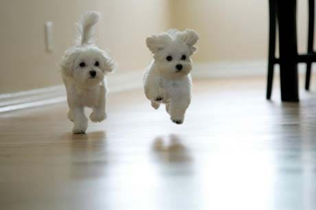
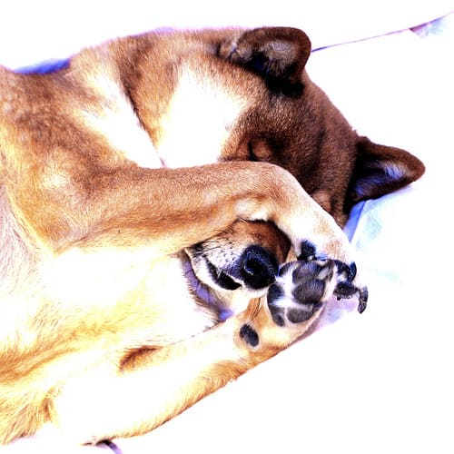
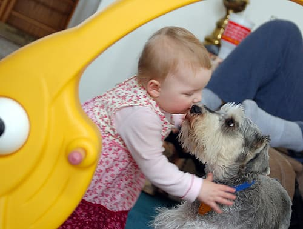
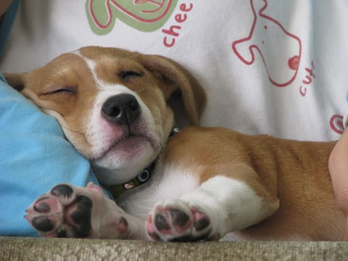
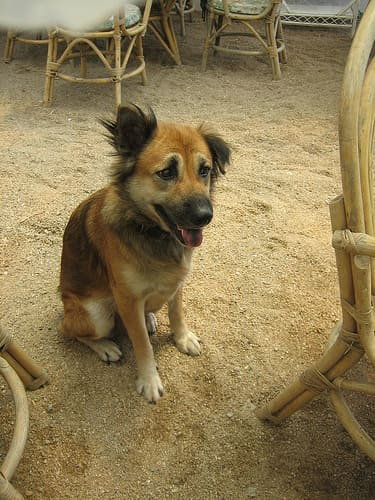
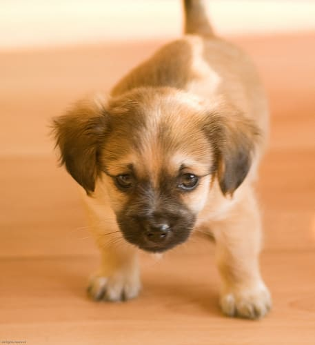
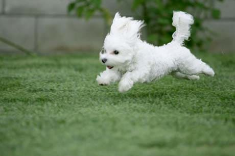
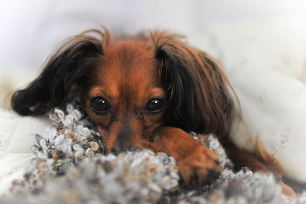
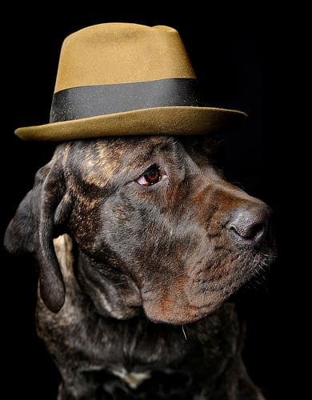

*Originally published on [Green Prophet](https://www.greenprophet.com/2010/03/11-things-i-learned-from-my-dog/)*

The other night my dog passed away. Looking back over the past ten years I realized that I had learned many valuable lessons from her. This post is a summary of those lessons, for your benefit …and a eulogy. This is not a Thoreau-ian post about how we should get back in touch with nature, but more about how I grew from seeing the world through a completely different perspective. However, isn’t – being in touch with the world around you – just what being environmentally friendly is all about?

<figure class="wp-block-image aligncenter size-large"></figure>

## 1\. Get excited about going for a walk

Every dog owner knows that dogs have a special radar, so if you even think about going for a walk, dogs can read something in your body language and like a bullet are at the door the very instant you start thinking about a walk, let alone actually say the word “walk”. “Puppy”, my dog, would get so excited, jumping around, jumping on you, when we were getting ready to take her out it was a challenge to get the leash on her, until we taught her ‘sit’.

People aren’t built to sit in an office from 9-5 daily. A dear friend learned recently, the hard way, that if you don’t get up from time to time you can get sick, or worse. In “[Stand Up While You Read This](http://opinionator.blogs.nytimes.com/2010/02/23/stand-up-while-you-read-this/)” Olivia Judson points out that “…sitting is one of the most passive things you can do. You burn more energy by chewing gum or fidgeting than you do sitting still in a chair.” Puppy taught me to go for a walk and explore the world around me.

<figure class="wp-block-image aligncenter size-large"></figure>

## 2\. Stop and smell the flowers / Sniff out the news

When you’re a dog, you want the flowers to smell like dog-piss and Puppy would stop at every single flower to smell it. One challenging aspect of walking a dog is getting past every fire hydrant, or wall for that matter. After a rain it was always particularly difficult to get more than three feet with Puppy outside. But I guess it’s like Facebook for her. Which dog peed where? Is there anyone new it the neighborhood?

The reason why we’re obsessed with social networking is that it’s so important to know what is happening in your neighborhood. Craig’s List, and sites of a similar nature, were designed just for our “sniffing” purposes. Who’s new in town? Which is the best doctor to visit for X? Where can I get the best deals… In truth, you never know when you can lend a hand, or need an hand lent.

<figure class="wp-block-image aligncenter size-large"></figure>

## 3\. Don’t waste food

It’s a lot easier to be environmentally friendly with your waste when you have a dog. Better than a compost heap in many ways, Puppy would always jump around excitedly when the meal was over and she knew she’d be getting her treat. (Even on Fraggle Rock a compost heap doesn’t jump for joy when you give it your leftovers.) Living with Puppy heightened my awareness of what I eat, and what I potentially waste. When I cook now, I try more carefully to judge portions and not waste good food.

<figure class="wp-block-image aligncenter size-large"></figure>

## 4\. Give a kiss to say “thank you”

Puppy always loved getting tasty morsels of food we left over, such as yummy chicken skin, or cheese. But whenever we gave her something she’d always kiss our hand, a quick lick. It wasn’t that she was trying to get some remaining grease, you knew when she sniffed that grease. This lick was a kiss, a quick: “Thanks for the food!” It cost her nothing, just a very quick postponement of gratification to show her appreciation. But I’ll tell you, getting those kisses made me want to keep giving her those treats.

I learned from Puppy that no small deed is too small to merit a thank you. My wife laughs when I thank her for a kiss, but I appreciate them, so I say thank you.

<figure class="wp-block-image aligncenter size-large"></figure>

## 5\. Love unconditionally

Puppy was always excited to see you. And she made sure that you KNEW it! Most dog owners I know describe the same experience: whenever I came through the door, puppy would be there jumping, excited as if I had been gone forever, even if I had only been out for an hour.

If you love someone, shouldn’t you let them know? How often do you greet the people you care about at the door?

<figure class="wp-block-image aligncenter size-large"></figure>

## 6\. Get pet any chance you get

Sitting and reading with Puppy around needed three hands: one hand to hold the book, one hand to turn pages …and one hand to pet Puppy. She wouldn’t have it any other way. We all need touch, and one thing I learned from Puppy was that if I needed a hug, or a hand held, it’s okay to ask for it. I loved petting my dog, and she loved being petted. That’s the way we are.

<figure class="wp-block-image aligncenter size-large"></figure>

## 7\. Protect the people you love

My grandmother lives with us, in a separate, but adjacent, apartment. Whenever my grandmother would go to answer the door, Puppy would come running to see who it was. She cared about us, and even saved us from several burglaries. I learned from Puppy that if I care about someone, I should make sure that they are okay. If a guest stays late, I make sure that they can get home safely — it’s not just chivalry. It’s safety.

<figure class="wp-block-image aligncenter size-large"></figure>

## 8\. Bark!

Don’t be afraid to let someone know that you don’t trust them, or what they’re up to. When someone came to the door that Puppy didn’t know, she would bark. Sure, that can be a little intimidating for guests, but I’d rather be safe. Once she saw that we trusted a guest, she would go back to her daily nap. I learned from Puppy that it’s okay to call someone out when you don’t trust them. I found that it’s usually good that I said something, because people usually put their own interests first, whether it’s justified or not.

<figure class="wp-block-image aligncenter size-large"></figure>

## 9\. Run

When we would let Puppy off her leash to run she would lose ten years, figuratively. It would always be a chore to get her back on the leash and bring her home, she loved running in the hills near our house so much. It took ten years off my age just watching her, it would bring me back to a time that everything was new, fresh. Puppy must have run through those fields hundreds of times, but she was always excited to run through them again. I learned from Puppy that a good run does you good, and it makes your life that much more fun when you get excited about things you love doing.

<figure class="wp-block-image aligncenter size-large"></figure>

## 10\. Appreciate the sunrise

Puppy used to sleep at my feet, and one summer we used to get up before I had to go out and run in the fields. Each day Puppy would wake me up a little earlier than the day before ’till we were waking up before the sunrise. After running I liked to sit by a bench on the side of the road overlooking the valley near my home and I noticed that Puppy would face the valley, even if the bench did not. I could usually tell if she had seen something that she would have liked to chase, a deer for instance. She would tense up and you could see her chasing that deer in her mind’s eye. Wishing that she were just a little closer…

On these mornings I could see that she was just looking at the view. It looked like she was just enjoying the sunrise. How often do we do that? It was really Puppy that made that happen, waking me up so that we could share those breathtaking sunrises. No wonder she couldn’t wait to get up.

<figure class="wp-block-image aligncenter size-large"></figure>

## 11\. Wear your emotions on your butt / Let people know how are feeling

You could always tell what mood Puppy was in. You just had to look at her tail. I learned about the power of being honest with my emotions from Puppy. If you don’t express how you are feeling, how can you expect the people around you to be sensitive to your needs? Like it or not, we are social, and part of living with others is giving them cues to how we are doing. Puppy would make sure I knew when she wanted to be petted, when she needed to go for a walk and when she just wanted to nap. It helped me be a good friend to her, as she was to me. Whenever I was down, she could tell and would come over and nudge me, make me pet her. It always made me feel better.

Puppy adopted my family about ten years ago, she jumped over the garden wall of my parent’s home and my father pointed out that if she could, a burglar could as well. So we kept her. She passed away from anaphylactic shock the other night after a walk, we’re not sure if it was from something she ate, or something that bit her. The vet was not able to tell, and couldn’t save her.

We’ll miss you Puppy.
